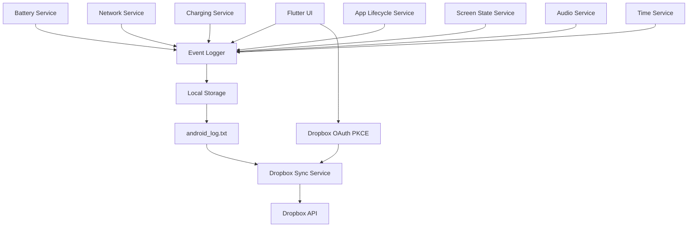

# Android Logger

**Real-Time Device Activity Monitor**

Android Logger is a Flutter application for Android. It records a small set of device events that a normal app is allowed to see, keeps that history on the device, shows it as it happens, and can upload one log file to the signed-in user's Dropbox account.

## Abstract

Phones already broadcast useful facts about themselves: the battery changed, a charger was connected, Wi-Fi came up, the screen turned off, the clock was set. Those facts are easy to miss because they are not written down. Android Logger turns the ones a normal application may observe into a private, readable log. The log stays on the device until the user chooses to export it or replace `/android_log.txt` in Dropbox. The app does not read other applications, keystrokes, messages, or the microphone.

## Introduction

Android Logger is a personal activity log for the device itself. Open the app, press **Start Logging**, and the dashboard shows the current battery, network, charging state, and Dropbox status, plus the newest events from this session. Stop logging when you want the file to stop growing. Search and filter the saved history, share `android_log.txt`, or sync that file after connecting Dropbox.

The app explains its scope on the Privacy screen. Logging is visible. There is no background monitoring service and no Accessibility Service.

## Problem Statement

Device state changes are scattered across system notifications and settings screens. A student or developer who wants a timestamped record of battery, network, charging, screen, volume, and clock changes has to watch the device by hand. Copying that record to another machine is a separate step.

A normal Android app also cannot, and must not, solve this by watching everything the user does. Other apps' screens, typed text, SMS, and calls are private. The useful problem is narrower: record the device events Android already exposes, keep them after the app restarts, and give the user an explicit way to copy the file to Dropbox.

## Objectives

- Record seven legitimate event categories and nothing more sensitive.
- Show the latest events without a manual refresh.
- Keep the log in application-private storage so it survives restart.
- Export one readable file, `android_log.txt`.
- Upload that file with Dropbox OAuth 2.0 Authorization Code and PKCE.
- Keep logging on disk when the internet is unavailable, and never delete the local log because a sync failed.
- Tell the user what is collected, what is not, and where it goes.

## Features

- Live dashboard with logging state, session start, session duration, and event count.
- Battery, network, charging, and Dropbox status cards driven by current application state.
- Start, stop, view logs, and sync actions that follow the real session and upload state.
- Persistent JSON Lines history and a readable text export.
- Logs screen with search, category chips, a date filter, pull-to-refresh, clear, and share.
- Light, dark, and system themes, saved on the device.
- Dropbox connect, manual authorization-code entry, upload progress, success, failure with retry, and disconnect.
- Offline banner. Local logging continues. Sync stays unavailable until the internet check succeeds.
- Privacy screen and in-app category switches.

## Supported Events

Exactly seven categories are implemented.

### 1. Battery

`BatteryService` reads the current level and charging condition. On Android, level changes come from the sticky `ACTION_BATTERY_CHANGED` broadcast, which `battery_plus` does not stream by itself. A 60-second `battery_plus` read is a backup. The same percentage is not written again. A session starts with a baseline such as `Battery level is 82%`. A later change is `Battery level changed to 81%`.

### 2. Network

`NetworkService` listens to `connectivity_plus`. That stream reports the radio: Wi-Fi, mobile, Ethernet, VPN, satellite, another transport, or none. It does not prove the internet works. After a real transport change, the app requests `https://connectivitycheck.gstatic.com/generate_204` and treats HTTP 204 or 200 as internet access. Examples: `Wi-Fi connected`, `Mobile network available`, `Network unavailable`, `Internet access available`, `No internet access`.

### 3. Charging

`ChargingService` watches the same battery snapshot for charger and charge transitions. It logs lines such as `Charging started` and `Charging stopped`, and it can tell a connected-but-not-charging state from discharging. The dashboard charging card uses the same snapshot.

### 4. App lifecycle

`AppLifecycleService` observes this process through Flutter's `WidgetsBindingObserver`. It logs `Application resumed`, `Application inactive`, `Application paused`, `Application hidden`, and `Application stopped` (the detached state). The same state is not logged twice in a row. Screen visits such as `Dashboard opened`, `Logs screen opened`, and `Log export started` are logged only while a logging session is active. The app does not watch other applications.

### 5. Screen state

While the process is alive, a dynamically registered receiver listens for `ACTION_SCREEN_ON`, `ACTION_SCREEN_OFF`, and `ACTION_USER_PRESENT`. Android does not allow those screen broadcasts to be registered in the manifest. The first on or off reading is a baseline (`Screen is on` or `Screen is off`). Later changes are `Screen turned on` and `Screen turned off`. `ACTION_USER_PRESENT` is logged as `User present after lock screen`. That means the keyguard was dismissed. It is not a record of a PIN, password, or pattern. These events are missed if the process is not running. There is no foreground service, because that would keep watching after the user left the app.

### 6. Audio / volume

A `ContentObserver` on `Settings.System` reports changes for the media, notification, ring, and alarm streams. The log line is the stream name, for example `Media volume changed`, plus the new level in metadata. The first reading is a baseline and is not logged as a change. The microphone is never opened. Conversations and media content are not recorded.

### 7. Time / date

The same dynamic receiver listens for `ACTION_TIME_CHANGED`, `ACTION_TIMEZONE_CHANGED`, and `ACTION_DATE_CHANGED`. A 60-second check compares a stopwatch with the wall clock. A skew larger than 45 seconds is `System time changed`. Date and time zone are compared separately. The same description is suppressed for five seconds. The clock is not logged every second.

## Technology Stack

| Piece | Choice |
| --- | --- |
| UI | Flutter, Dart, Material 3 |
| State | `provider` (`ChangeNotifier`) |
| Battery | `battery_plus` plus `ACTION_BATTERY_CHANGED` |
| Network | `connectivity_plus` plus an HTTP 204 probe |
| Files | `path_provider` (application support directory) |
| Preferences | `shared_preferences` |
| Tokens | `flutter_secure_storage` |
| Dropbox | HTTPS calls to the official HTTP API |
| Sign-in | OAuth 2.0 Authorization Code with PKCE (`crypto`, `flutter_web_auth_2`) |
| Share export | `share_plus` |
| Version | `package_info_plus` |

Versions are pinned in `pubspec.yaml` for Flutter 3.41 / Dart 3.11 (`sdk: ^3.11.3`). Android `minSdk` is at least 24 because secure storage needs a current Android baseline. The application id is `com.example.android_logger`.

## Requirements

- Flutter SDK stable (this project was built with Flutter 3.41.5 and Dart 3.11.3)
- Android SDK, with a device or emulator
- Android 7.0 (API 24) or newer
- A Dropbox app key only if you want sync. Logging, search, and export work without it
- Internet permission, already declared, for the reachability probe and Dropbox

## Installation

From the project root:

```bash
flutter doctor
flutter pub get
flutter analyze
flutter test
flutter run
```

Optional Dropbox key at compile time:

```bash
flutter run --dart-define=DROPBOX_APP_KEY=your_app_key
```

You can leave that out and type the app key on the Dropbox screen instead. Do not pass an access token, refresh token, or client secret.

Debug package:

```bash
flutter build apk --debug
```

## Project Structure

```text
lib/
  main.dart                 Startup, loading, and retry
  app.dart                  Providers, theme, routes
  bootstrap.dart            Real Android plugins, or empty sources in tests
  models/                   LogEvent, EventType, sync state, device snapshots
  services/                 Logger, seven monitors, storage, Dropbox, PKCE
  providers/                Logging, device status, Dropbox, settings
  screens/                  Dashboard, logs, Dropbox, settings, privacy
  widgets/                  Cards, live list, buttons, empty/error/offline views
  platform/                 Android event channel parsers
  utils/                    Timestamps and safe metadata
android/.../DeviceEventBridge.kt
  Screen, time, and battery broadcasts, plus the volume observer
test/                       Model, storage, logger, monitor, Dropbox, and widget tests
```

`bootstrap.dart` is the only place that constructs `Battery()`, `Connectivity()`, and the Android event channel. Tests build the same controllers with in-memory fakes, so `flutter test` does not need a phone or Dropbox credentials.

## System Architecture



Device monitors run while the process is open so the dashboard cards stay current. `EventLoggerService` writes a line only after **Start Logging**, and only for categories enabled in Settings. One `bind()` attaches the device stream. Calling start again does not add another listener.

## Event Data Flow

```text
Android event or plugin update
        |
        v
Service interprets the change and drops duplicates
        |
        v
DetectedEvent
        |
        v
EventLoggerService builds a LogEvent
        |
        v
events.jsonl in application-private storage
        |
        v
onStored stream
        |
        v
LoggingController notifies the dashboard and logs screen
```

A `LogEvent` has `id`, `timestamp`, `type`, `description`, and `metadata`. The id looks like `event_<microseconds>_<counter>`. The timestamp is an ISO-8601 string with a numeric offset. Metadata keys that look like secrets (`access_token`, `refresh_token`, `password`, `client_secret`, and similar) are removed before the event is stored. `LogEvent.tryParse` rejects a broken line instead of throwing it into the UI.

Example:

```json
{"id":"event_001","timestamp":"2026-10-24T13:20:30+05:30","type":"battery","description":"Battery level changed to 82%","metadata":{"batteryLevel":82}}
```

## Real-Time Architecture

`DeviceStatusController` owns the monitor subscriptions and exposes battery, network, and screen state. `LoggingController` listens to the logger's stored-event stream. Both are `ChangeNotifier`s. Widgets watch them with `provider`, so a new event rebuilds the live list and the counters. Relative times such as "2 minutes ago" tick once a second in the widget that displays them. No pull-to-refresh is required on the dashboard. The logs screen still has one, which re-reads the file.

## Battery Monitoring

`BatteryPlusSource` subscribes to `onBatteryStateChanged` and polls `batteryLevel` every 60 seconds. The Android bridge also emits `ACTION_BATTERY_CHANGED`, which includes the level, status, and plug type. `BatterySnapshot.merge` keeps the last known field when a source omits it. `BatteryService` emits a description only when the level or the reported condition actually changes.

## Network Monitoring

`connectivity_plus` is stream-based. The app does not poll the radio. Each new result updates the transport label immediately. If the radio is not `none`, an internet probe runs. An older probe result is ignored if a newer change arrived while it was in flight. `canSync` is true only when a transport exists and the internet check did not fail.

## Charging Monitoring

Charging is not a second battery API. It is the plug and charge fields of the battery snapshot. Connection labels distinguish USB, AC, wireless, dock, and no charger when Android reports them. Charge labels distinguish charging, full, connected but not charging, and not charging.

## App Lifecycle Monitoring

Flutter delivers `AppLifecycleState` for this activity. The interpreter maps each value to one sentence and ignores a repeat of the same value. On resume, the app rechecks the network and the clock. Opening a screen calls `logAppAction` once. That path does not subscribe to anything new, so it cannot create a loop of lifecycle events.

## Screen State Monitoring

Android delivers `ACTION_SCREEN_ON` and `ACTION_SCREEN_OFF` only to receivers registered at runtime, and only to a running process. From API 33 the receiver is registered with `RECEIVER_NOT_EXPORTED`. The app also reads `PowerManager.isInteractive` once for the baseline. It does not use the Accessibility API, a device-admin receiver, or a foreground service to see the screen while the process is dead. `ACTION_USER_PRESENT` is the supported "someone unlocked the keyguard" signal. The unlock secret is not available and is not requested.

## Audio / Volume Monitoring

Volume is read from `AudioManager` for `STREAM_MUSIC`, `STREAM_NOTIFICATION`, `STREAM_RING`, and `STREAM_ALARM`. The observer watches the system settings URI and emits a line only when a level changes. This is device volume state. It is not an audio recording. The `RECORD_AUDIO` permission is not requested.

## Time / Date Monitoring

`TimeService` stores a baseline wall time, calendar day, zone id, and offset. Broadcasts set the change kind to `time`, `timezone`, or `date`. The one-minute poll catches a clock step that did not produce a broadcast the process could see. A one-second ticker is intentionally not used.

## Local Storage

Events are appended to `events.jsonl` under the application support directory from `path_provider`. Writes are serialized so two events cannot interleave lines. On load, a corrupt line is skipped and counted. The user-facing export is `android_log.txt` in that same private directory:

```text
ANDROID LOGGER
Generated: 24 October 2026

------------------------------------------------

2026-10-24 13:20:30
BATTERY
Battery level changed to 82%
```

Search compares the description, type name, type label, and timestamp. Hyphens are ignored, so `wifi` matches `Wi-Fi`. Category filters use `EventType`. A date chip limits the list to one calendar day. Clear deletes the local file. Export shares the text file through Android's share sheet. No broad storage permission is requested.

## Dropbox Integration

Create the Dropbox app before expecting sync to succeed.

1. Create a Dropbox account and open the [App Console](https://www.dropbox.com/developers/apps).
2. Choose **Create app**.
3. Choose the **Scoped access** API.
4. Choose **App folder** access. Full Dropbox access also works, but App folder is the smaller permission. With App folder, the API path `/android_log.txt` is stored as `Apps/<your app name>/android_log.txt`.
5. Name the app.
6. Open the **Permissions** tab, enable `files.content.write`, and press **Submit**. This is the only file scope the app requests.
7. Open **Settings**. Under OAuth 2, add this redirect URI exactly: `androidlogger://oauth2redirect`.
8. Copy the **App key**. Leave the app secret out of the project. This client is public and uses PKCE.
9. In Android Logger, open Dropbox, paste the app key, and press **Save app key**. Or build with `--dart-define=DROPBOX_APP_KEY=...`.
10. Press **Connect Dropbox**. The browser asks you to allow the app. The redirect returns to Android Logger.
11. If the browser does not come back, use **Open Dropbox code page** and paste the code Dropbox shows. That path omits the redirect URI so Dropbox can display a code. The code is exchanged once and is not written to the log.
12. Press **Sync Now**. The app generates `android_log.txt` and uploads it. Success is shown only after Dropbox returns HTTP 200 and a file id, rev, or `path_lower`.

The upload calls `POST https://content.dropboxapi.com/2/files/upload` with `mode` `overwrite`, `autorename` false, and `mute` true. Every sync replaces `/android_log.txt`. It does not create `android_log (1).txt`, `android_log (2).txt`, and so on.

Disconnect deletes the tokens from secure storage and calls Dropbox's token revoke endpoint. The app key remains so you can connect again. Clear logs does not delete the Dropbox copy.

## OAuth + PKCE

OAuth lets the app act on your Dropbox without learning your Dropbox password. The authorization code flow sends you to Dropbox, then Dropbox sends back a short-lived code. PKCE (Proof Key for Code Exchange) binds that code to this app: a random verifier stays on the device, and Dropbox receives only its SHA-256 challenge. A stolen code is not useful without the verifier. A random `state` value is checked on return so a mismatched redirect is rejected. `token_access_type=offline` asks for a refresh token. The access token is refreshed when it is missing or within 60 seconds of expiry, and once more if an upload receives HTTP 401. Tokens live in `flutter_secure_storage`. They are not written to source, logs, or `android_log.txt`.

## Security

- HTTPS only for Dropbox and the internet probe.
- PKCE S256 and OAuth `state` checks.
- Tokens in encrypted storage. Disconnect revokes the remote token.
- No client secret, access token, or refresh token in the repository. `.gitignore` ignores `.env`, `dropbox_config.json`, keystores, and `android_log.txt`. `.env.example` documents the optional app key and contains no secret.
- Permissions are `INTERNET` and `ACCESS_NETWORK_STATE`.
- Log metadata drops secret-looking keys.
- The redirect activity uses an empty `taskAffinity`, and the screen receiver is not exported.

## Privacy

The Privacy screen in the app states the same rules. Collected items are battery level and charging state, network type, the result of the internet check, this app's lifecycle and screen visits, screen on/off, the user-present signal, volume levels, and system time, date, or zone changes. Not collected: keystrokes, passwords, messages, call or SMS content, microphone audio, photos, or activity inside other apps. Data is stored in the app's private directory. It is uploaded only when you press Sync. Disconnect removes the local Dropbox session. Clear logs deletes the local history and leaves any Dropbox copy for you to delete in Dropbox.

## Offline Behavior

If the radio is down, the dashboard says you are offline and that logs continue to be stored locally. If the radio is up but the internet probe fails, sync stays disabled and the local file is kept. Starting or stopping a session does not need a network. A failed upload does not clear `events.jsonl`.

## Testing

Automated tests live in `test/` and use fakes:

| Area | What is checked |
| --- | --- |
| Models | JSON round trip, invalid payloads, secret metadata, event type parsing |
| Storage | Save, append, read, corrupt lines, search, clear, export text |
| Logger | Start, duplicate start, stop, ignored events while stopped |
| Monitors | Battery, charging, network versus internet, screen, volume, lifecycle, time, PKCE RFC 7636 vector, native payload parsing |
| Dropbox | Auth success, cancel, failure, state mismatch, upload success only after confirmation, upload failure, refresh after 401, disconnect |
| Widgets | Dashboard start/stop and a live battery change, loading, error, empty, offline, log search and filters, log load error, Dropbox disconnected, connected, uploading, success, and failure |

Run `flutter test`. No Dropbox account is contacted.

### Manual test checklist

Run these on an Android device or emulator after `flutter run`. Dropbox rows need an app key configured as above.

| Test | Expected Result |
| --- | --- |
| Start Logging | Status becomes ● LOGGING ACTIVE and the session clock starts |
| Stop Logging | Status becomes ○ LOGGING STOPPED and new device changes are not stored |
| Battery changes | A battery event appears and the battery card updates |
| Charging starts | A charging-started event appears |
| Charging stops | A charging-stopped event appears |
| Wi-Fi changes | A network event appears. Internet is a separate line |
| Mobile network changes | A mobile network event appears |
| App resumes | An app lifecycle event appears |
| Screen state changes | Screen on/off appears while the process is alive |
| Volume changes | A media, notification, ring, or alarm volume line appears |
| System time changes | A time, date, or zone line appears. The clock does not log every second |
| App restart | Previous logs are still on the Logs screen |
| Search | Matching descriptions, types, and times remain |
| Filter | A selected category remains. Deselecting one hides it |
| Export | The share sheet offers `android_log.txt` |
| Dropbox Connect | The browser returns and the screen shows Connected |
| Dropbox Sync | The progress indicator finishes only after Dropbox accepts the file |
| No Internet | New events still append locally. Sync stays unavailable |
| Upload failure | Sync Failed and Retry are shown. Local logs remain |
| Disconnect Dropbox | Status returns to Not Connected and the stored tokens are removed |

## Troubleshooting

- **Analyzer or test failure after a Flutter upgrade.** Run `flutter pub get`, then `flutter analyze` and `flutter test`.
- **Dropbox says the redirect URI is invalid.** The console value must be exactly `androidlogger://oauth2redirect`.
- **Connect opens the browser and never returns.** Use **Open Dropbox code page**, copy the code, and paste it into the app.
- **Upload returns a permissions error.** Enable `files.content.write` and press Submit on the Permissions tab. The scope string is `files.content.write`.
- **Sync stays disabled.** The internet probe did not get HTTP 204 or 200. Local logging can still be active.
- **No screen or volume events after a reboot.** Those receivers exist only while Android Logger's process is running. Open the app.
- **Battery percentage looks late.** `battery_plus` has no level stream. The sticky battery broadcast is the fast path, with a 60-second backup read.
- **A log line is missing after a crash.** The writer skips malformed JSON lines and continues with the rest of the file.

## Limitations

- This is not kernel monitoring and not a record of other apps.
- Screen, volume, and clock broadcasts are missed while the process is dead. The app does not add a foreground service to avoid that.
- `ACTION_USER_PRESENT` means the lock screen was dismissed. It does not reveal the lock secret.
- `battery_plus` reports charging state. Percentage changes depend on `ACTION_BATTERY_CHANGED` or the backup poll.
- A Wi-Fi or mobile icon is not treated as internet access.
- Dropbox success in the UI requires a real API confirmation. Tests fake that HTTP boundary. A phone upload still needs your own Dropbox app key.
- Clear logs does not delete `Apps/<app name>/android_log.txt` from Dropbox.
- The project targets Android. The Dart UI can build elsewhere, but the device bridge is Android-only.

## Future Enhancements

- A user-visible export reminder when many events are unsynced.
- Optional automatic sync after the user opts in, still without a hidden watcher.
- A richer charging label when the device reports wireless or dock power.
- Localization of the log sentences.
- A tablet layout that keeps the live list beside the status cards.

## Conclusion

Android Logger is a small, visible monitor for device events Android already allows an ordinary app to see. It stores them privately, shows them as they arrive, and uploads one replaced log file when the user asks Dropbox to accept it.

## Operating System Concepts

The app uses operating-system services. It does not run inside the kernel and does not install a driver.

### Event handling

Android sends broadcasts and settings callbacks. The app registers interest and runs a small interpreter when one arrives. That is event-driven programming: the code reacts to `ACTION_BATTERY_CHANGED` or a volume change instead of guessing on a tight loop.

### I/O

Each accepted event is an append to a private file. Export reads those events back and writes `android_log.txt`. Reading and writing files is operating-system I/O, done asynchronously so the interface can keep drawing.

### File management

The application support directory is the app's private folder. The program creates it, appends `events.jsonl`, replaces the export file, and deletes both when the user clears logs. No shared-storage permission is required because the files are not in a public directory.

### Networking

The internet probe and Dropbox use the platform network stack over HTTPS. Dropbox is a remote service with an HTTP API. The app does not open a raw socket of its own beyond what `dart:io` and `package:http` provide.

### Asynchronous processing

Broadcasts, file appends, the internet probe, and the upload each complete later. Dart futures and streams represent that work. The UI isolate stays responsive because those calls yield instead of blocking the frame.

### Resource monitoring

Battery level and charging state are resource information from Android's battery service. Connectivity is resource information from the network stack. The app displays them. It does not change kernel scheduling or power policy.

### Process and application lifecycle

Android can pause, stop, or kill the process. Flutter reports those transitions, and the logger records them for this app only. When the process dies, dynamic receivers die with it. On the next launch, saved logs are read from disk, and logging resumes only if the user left it enabled.

### Permissions and security

Android's sandbox stops this app from reading another app's files. Dangerous permissions that would widen that hole are not requested. Dropbox tokens are another credential boundary: they are stored with the platform's secure storage and revoked on disconnect.

### Concurrency

The network probe can be in flight while a battery broadcast arrives and a file write is queued. The storage service serializes writes. The probe generation counter drops stale internet results. Those are concurrent operations coordinated in user space. They are not parallel kernel threads that the app manages directly.

## Viva Questions

1. **What is Android Logger?**  
   A Flutter Android app that records seven kinds of device events, stores them privately, shows them live, exports `android_log.txt`, and can replace that file in the user's Dropbox.

2. **What is an event?**  
   A `LogEvent`: an id, a timestamp, an `EventType`, a short description, and optional metadata. Example: type `battery`, description `Battery level changed to 82%`.

3. **Why use event-driven programming?**  
   Battery, screen, volume, and clock changes arrive when Android says they happened. The app updates then, instead of polling every second and writing duplicate lines.

4. **How is battery monitoring implemented?**  
   `battery_plus` supplies the charging state and a 60-second level read. `ACTION_BATTERY_CHANGED` supplies level changes. `BatteryService` logs only when the value changes.

5. **How is network monitoring implemented?**  
   `connectivity_plus` reports the transport. A separate HTTP request to `generate_204` checks internet access. Wi-Fi connected does not by itself mean internet available.

6. **How is charging detected?**  
   From the battery snapshot's charge state and plug type. Transitions become lines such as `Charging started` and `Charging stopped`.

7. **What is application lifecycle?**  
   The states Android and Flutter report for this process: resumed, inactive, paused, hidden, and detached. The app logs one line per real change for itself only.

8. **What is a stream?**  
   A sequence of values over time. Device events and stored log lines are streams. The UI listens and rebuilds when a new value arrives.

9. **What is asynchronous programming?**  
   Starting work that finishes later, such as a file append or an upload, without freezing the interface. Dart uses futures and `async`/`await`.

10. **How is local storage implemented?**  
    JSON Lines in `events.jsonl` under the application support directory. Corrupt lines are skipped. The readable copy is `android_log.txt`.

11. **Why use JSON?**  
    Each event is one JSON object, so the file can be appended and parsed line by line, and a bad line does not destroy the rest.

12. **Why generate a text log?**  
    `android_log.txt` is the file a person can read and the file Dropbox stores. The JSON file is the internal history.

13. **What is Dropbox?**  
    A cloud file service. This app uploads a single log file into the user's account after they approve it.

14. **What is an API?**  
    A defined way for one program to ask another to do something. Dropbox's HTTP API accepts the upload and returns file metadata.

15. **What is REST?**  
    An HTTP API style. Dropbox's upload endpoint is a POST to `https://content.dropboxapi.com/2/files/upload` with the file bytes and a JSON API argument.

16. **What is OAuth?**  
    A way to grant this app limited Dropbox access without giving it the Dropbox password. The user approves the app in the browser, and the app receives tokens.

17. **What is PKCE?**  
    Proof Key for Code Exchange. The app sends a hash of a secret verifier when asking for a code, then sends the verifier when exchanging the code. The code is useless to someone who does not have the verifier. This app uses SHA-256 (`S256`).

18. **Why is secure token storage necessary?**  
    Access and refresh tokens can upload files to the user's Dropbox. `flutter_secure_storage` keeps them out of the log file and out of ordinary preferences.

19. **Why can't we monitor every application?**  
    Android sandboxes apps. A normal app does not receive another app's keystrokes, screens, or private files. This project does not try to bypass that.

20. **What is Android sandboxing?**  
    Each app runs with its own identity and storage. Android Logger can read its own log file. It cannot read another app's data unless that app shares it.

21. **What happens when there is no internet?**  
    Events keep appending locally. The dashboard says sync is unavailable. Nothing is deleted.

22. **How does synchronization work?**  
    Sync builds `android_log.txt`, checks that Dropbox is connected and the internet probe succeeded, uploads with overwrite, and shows success only if the response includes a file id, rev, or `path_lower`. HTTP 401 refreshes the token once and retries once.

23. **How does the UI update in real time?**  
    The logger's `onStored` stream updates `LoggingController`, which calls `notifyListeners()`. Widgets that watch that controller rebuild. The battery card updates from `DeviceStatusController` the same way.

24. **How are duplicate listeners prevented?**  
    `EventLoggerService.bind` returns immediately if it has already subscribed. Each monitor stores a `_started` flag. The Android bridge replaces an existing receiver instead of registering a second one. Screen and volume baselines ignore the first sample.

25. **What are the project's limitations?**  
    It cannot see other apps, it misses screen, volume, and time events while its process is dead, and Dropbox upload works only after a real app key and a confirmed API response.

26. **How is user privacy protected?**  
    The category list is fixed and documented. There is no microphone, no accessibility service, and no hidden logger. Upload and delete are user actions. Tokens are revocable.

27. **What happens after application restart?**  
    `events.jsonl` is loaded again. If the user had left logging enabled, the session starts again. Dropbox tokens remain in secure storage until disconnect. Screen and volume events from while the process was dead are not backfilled.

28. **What happens if Dropbox upload fails?**  
    The Dropbox screen shows Sync Failed and Retry. The local log is unchanged.

29. **What is asynchronous I/O?**  
    A read or write that the operating system performs while the app does other work. Appending a log line and uploading bytes are both asynchronous I/O.

30. **What future improvements can be made?**  
    Optional user-chosen automatic sync, localization, a clearer unsynced count, and a wider layout for large screens. A hidden always-on monitor is not one of them.

## References

- Flutter documentation: https://docs.flutter.dev/
- Dart documentation: https://dart.dev/guides
- Android broadcasts: https://developer.android.com/develop/background-work/background-tasks/broadcasts
- `ACTION_SCREEN_ON` and `ACTION_SCREEN_OFF`: https://developer.android.com/reference/android/content/Intent
- `ACTION_BATTERY_CHANGED`: https://developer.android.com/reference/android/content/Intent#ACTION_BATTERY_CHANGED
- `ACTION_USER_PRESENT`: https://developer.android.com/reference/android/content/Intent#ACTION_USER_PRESENT
- Android application sandbox: https://source.android.com/docs/security/app-sandbox
- Dropbox developers: https://www.dropbox.com/developers
- Dropbox app console: https://www.dropbox.com/developers/apps
- Dropbox OAuth guide: https://developers.dropbox.com/oauth-guide
- Dropbox HTTP API: https://www.dropbox.com/developers/documentation/http/documentation
- PKCE, RFC 7636: https://datatracker.ietf.org/doc/html/rfc7636
- `battery_plus`: https://pub.dev/packages/battery_plus
- `connectivity_plus`: https://pub.dev/packages/connectivity_plus
